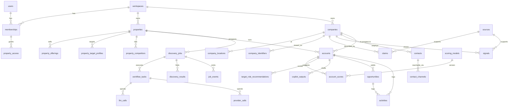

# Inhabitr — Database Schema

> Version 1.0 · 2026-11-09 · PostgreSQL 16 + PostGIS · SQLAlchemy 2 + Alembic
> Decisions: D-13 (tenant-scoped companies), D-14 (Account = Company × Property), P-01 (DB sessions), P-02 (DB queue), P-04 (two lifecycles), P-08 (demo separation)

---

## 1. Conventions

| Convention | Rule |
|---|---|
| Primary keys | `id UUID` (UUIDv7 generated in app → time-ordered, index-friendly) |
| Timestamps | `created_at`, `updated_at` `timestamptz NOT NULL DEFAULT now()` on every table |
| Tenancy | `workspace_id UUID NOT NULL` on every tenant-owned table + RLS policy |
| Enums | `text` + `CHECK (col IN (...))` (easier to migrate than Postgres ENUM types); values mirrored in Python `StrEnum` |
| Geography | `geography(Point, 4326)`; distances in metres via `ST_Distance`; GiST indexes |
| Money | `numeric(14,2)` + `currency char(3)` (default `INR`) |
| Costs | `numeric(12,6)` USD (vendor prices are USD) |
| Soft delete | `archived_at timestamptz NULL` only where users "delete" business records (properties, contacts, opportunities) |
| JSONB | Only for flexible/derived payloads (configs, breakdowns, raw provider data) — never for fields we filter on frequently |
| Naming | snake_case, plural table names, FK `<entity>_id` |

---

## 2. ER diagram (core)



**Key relationships explained**
- **Company is workspace-scoped, Account is property-scoped.** One Company row per real organisation per workspace; one Account per (Property, Company). Scores, status, owner, drafts and opportunities hang off the Account because they depend on *which hotel* is selling.
- **Claims & signals hang off the Company** (facts about the organisation are property-independent), each linked to a **Source**. Interpretation for a property happens in scoring.
- **Opportunity ⊂ Account.** An account can have several opportunities (corporate rate + an event).
- **Workflow tables** (`discovery_jobs`, `workflow_tasks`, `job_events`, `llm_calls`, `provider_calls`) give full traceability: which job/task/prompt produced which claim and what it cost.

---

## 3. Tables

### 3.1 Identity & access

**workspaces** — `id`, `name`, `slug` (unique), `is_demo bool NOT NULL DEFAULT false`, `settings jsonb` (default budget, limits, currency, timezone), timestamps.

**users** (global; not tenant-owned) — `id`, `email citext UNIQUE`, `full_name`, `password_hash`, `is_active bool`, `last_login_at`, timestamps.

**memberships** — `id`, `workspace_id`, `user_id`, `role` CHECK in (`admin`,`manager`,`rep`), `is_active`, timestamps. UNIQUE(`workspace_id`,`user_id`).

**property_access** — `id`, `workspace_id`, `membership_id`, `property_id`, timestamps. UNIQUE(`membership_id`,`property_id`). (Only consulted for `rep`.)

**sessions** — `id`, `token_hash bytea UNIQUE`, `user_id`, `workspace_id` (active), `csrf_token_hash`, `created_at`, `last_seen_at`, `idle_expires_at`, `absolute_expires_at`, `revoked_at`, `ip inet`, `user_agent`.

**auth_tokens** — `id`, `workspace_id`, `purpose` CHECK in (`invite`,`password_reset`), `email citext`, `role` (invites), `token_hash bytea UNIQUE`, `expires_at`, `used_at`, `created_by`.

### 3.2 Properties

**properties** — `id`, `workspace_id`, `name`, `brand`, `address_line`, `locality`, `city`, `state`, `postal_code`, `country` (default `IN`), `location geography(Point,4326)`, `lifecycle` CHECK in (`pre_opening`,`operating`), `opening_date date`, `rooms_count int`, `meeting_rooms_count int`, `largest_meeting_capacity int`, `banquet_capacity int`, `restaurants_count int`, `facilities text[]`, `description text`, `is_hypothetical bool NOT NULL DEFAULT false`, `archived_at`, timestamps.

**property_offerings** — `id`, `workspace_id`, `property_id`, `offering` CHECK in (`corporate_rate`,`mice`,`long_stay`,`fnb`), `details jsonb` (e.g. MICE: rooms/capacities; long stay: min nights), `is_active`, timestamps. UNIQUE(`property_id`,`offering`).

**property_target_profiles** — `id`, `workspace_id`, `property_id`, `name` (default "Primary"), `radius_km numeric(5,2)`, `industries text[]` (taxonomy codes), `employee_min int`, `employee_max int`, `notes text`, `is_default bool`, timestamps. (Multiple profiles allowed later; MVP uses one.)

**property_competitors** — `id`, `workspace_id`, `property_id`, `name`, `url`, `notes`, timestamps.

**industries** (global reference, seeded) — `code` PK, `label`, `parent_code`, `relevance` jsonb (offering → 0..1 default relevance).

### 3.3 Companies & evidence

**companies** — `id`, `workspace_id`, `name`, `normalized_name`, `primary_domain`, `industry_code` FK industries, `employee_range`, `description`, `hq_city`, `hq_country`, `data_origin` CHECK in (`real`,`mock`,`manual`), `research_status` CHECK in (`not_researched`,`researching`,`researched`,`failed`), `last_researched_at`, `do_not_contact bool DEFAULT false`, `merged_into_id` FK companies NULL, timestamps.
> Denormalised columns (`industry_code`, `employee_range`, `description`, `hq_*`) are a **projection** of current grounded claims, rebuilt by the research pipeline, for fast filtering. Claims remain the source of truth.

**company_locations** — `id`, `workspace_id`, `company_id`, `label`, `address`, `locality`, `city`, `location geography(Point,4326)`, `location_type` CHECK in (`hq`,`branch`,`delivery_center`,`plant`,`registered`,`unknown`), `is_primary_local bool`, `source_id` FK sources NULL, timestamps.

**company_identifiers** — `id`, `workspace_id`, `company_id`, `kind` CHECK in (`domain`,`osm_id`,`google_place_id`,`cin`,`linkedin_url`,`csv_ref`), `value`, timestamps. UNIQUE(`workspace_id`,`kind`,`value`).

**sources** — `id`, `workspace_id`, `url`, `canonical_url`, `source_type` CHECK in (`website`,`news`,`search_result`,`osm`,`google_places`,`csv_import`,`manual`,`provider`), `provider`, `title`, `published_at`, `retrieved_at NOT NULL`, `content_hash bytea`, `content_text text NULL` (retention-limited), `content_expires_at`, `http_status`, `license_tag` (e.g. `public_web`, `odbl`, `google_places`, `user_provided`), `exportable bool`, `data_origin`, `job_id` NULL, timestamps. UNIQUE(`workspace_id`,`canonical_url`,`content_hash`).

**claims** — `id`, `workspace_id`, `company_id`, `field` (controlled list), `value jsonb`, `kind` CHECK in (`fact`,`inference`,`unknown`), `source_id` NULL, `evidence_quote text`, `supports uuid[]`, `rationale text`, `confidence numeric(3,2)`, `grounding_status` CHECK in (`passed`,`passed_fuzzy`,`failed`,`not_applicable`), `grounding_detail jsonb`, `observed_at`, `is_current bool`, `superseded_by_id` NULL, `produced_by_task_id` NULL, `data_origin`, timestamps.
- CHECK `kind <> 'fact' OR (source_id IS NOT NULL AND evidence_quote IS NOT NULL AND grounding_status IN ('passed','passed_fuzzy'))`.
- Partial index on (`company_id`,`field`) WHERE `is_current`.

**signals** — `id`, `workspace_id`, `company_id`, `signal_type`, `title`, `description`, `source_id NOT NULL`, `evidence_quote`, `published_at` NULL, `discovered_at`, `event_date` NULL, `confidence`, `implied_offerings text[]`, `recommended_approach text`, `grounding_status`, `produced_by_task_id`, `data_origin`, timestamps. UNIQUE(`company_id`,`signal_type`,`source_id`).

### 3.4 Accounts & scoring

**accounts** — `id`, `workspace_id`, `property_id`, `company_id`, `status` CHECK in (`discovered`,`qualified`,`contact_identified`,`outreach_prepared`,`outreach_sent`,`engaged`,`dismissed`), `owner_membership_id` NULL, `dismissed_reason` CHECK in (…PRD FR-8.8…), `dismissed_note`, `distance_km numeric(6,2)`, `priority numeric(5,2)`, `tier` CHECK in (`A`,`B`,`C`), `fit`, `intent`, `confidence` (smallint, denormalised from current score), `actionability`, `current_score_id`, `first_seen_job_id`, `last_activity_at`, timestamps. UNIQUE(`property_id`,`company_id`).
> Score columns on `accounts` are a denormalised copy of the current `account_scores` row for fast sort/filter.

**scoring_models** — `id`, `workspace_id`, `version int`, `weights jsonb`, `params jsonb`, `is_active bool`, `notes`, `created_by`, timestamps. UNIQUE(`workspace_id`,`version`).

**account_scores** (append-only) — `id`, `workspace_id`, `account_id`, `scoring_model_id`, `fit`, `intent`, `confidence`, `actionability`, `priority`, `tier`, `breakdown jsonb`, `computed_at`, `computed_by_task_id`.

**target_role_recommendations** — `id`, `workspace_id`, `account_id`, `role_code`, `offering`, `rank`, `rationale`, timestamps.

**saved_views** — `id`, `workspace_id`, `membership_id`, `property_id` NULL, `scope` CHECK in (`accounts`,`contacts`,`opportunities`), `name`, `filters jsonb`, `sort jsonb`, `columns jsonb`, `is_shared`, timestamps.

### 3.5 Contacts

**contacts** — `id`, `workspace_id`, `company_id`, `full_name`, `title`, `role_code`, `profile_url`, `source_note text NOT NULL`, `source_id` NULL, `verification_status` CHECK in (`unverified`,`user_verified`,`provider_verified`), `verification_note`, `last_verified_at`, `do_not_contact bool`, `data_origin`, `created_by`, `archived_at`, timestamps.

**contact_channels** — `id`, `workspace_id`, `contact_id`, `kind` CHECK in (`email`,`phone`), `value`, `is_business bool`, `verification_status`, `last_verified_at`, timestamps.

### 3.6 Discovery & workflow

**discovery_jobs** — `id`, `workspace_id`, `property_id`, `created_by`, `status` (see SYSTEM_ARCHITECTURE §7.2), `config jsonb` (validated DiscoveryConfig), `nl_request text`, `estimate jsonb`, `budget_usd numeric(10,4)`, `spent_usd numeric(12,6)`, `reserved_usd`, `stage_counts jsonb` (maintained by engine), `cancel_requested bool`, `started_at`, `finished_at`, `error jsonb`, `data_origin`, timestamps.

**discovery_results** — `id`, `workspace_id`, `job_id`, `provider`, `raw jsonb` (license-filtered), `source_id`, `company_id` NULL, `outcome` CHECK in (`new`,`merged`,`filtered_out`,`duplicate`), `filter_reason`, timestamps.

**workflow_tasks** — `id`, `workspace_id`, `job_id`, `step`, `subject_type` (`job`,`company`), `subject_id`, `status` (see §7.2 of SYSTEM_ARCHITECTURE), `attempt int`, `max_attempts int`, `run_after`, `lease_expires_at`, `locked_by`, `input jsonb`, `output jsonb`, `error jsonb` (class, message, retryable), `cost_usd`, `started_at`, `finished_at`, `idempotency_key UNIQUE`, timestamps. Index (`job_id`,`status`), (`status`,`run_after`).

**queue_items** (owned by `PostgresQueueBackend`) — `id bigserial`, `task_id`, `priority`, `run_after`, `leased_by`, `lease_expires_at`, `enqueued_at`. Index (`run_after`,`priority`) WHERE `leased_by IS NULL`.

**job_events** (append-only, user-facing progress) — `id bigserial`, `workspace_id`, `job_id`, `level` (`info`,`warning`,`error`), `stage`, `message`, `data jsonb`, `created_at`.

**worker_heartbeats** — `worker_id` PK, `last_seen_at`, `version`.

**llm_calls** — `id`, `workspace_id`, `job_id` NULL, `task_id` NULL, `step`, `purpose` (e.g. `copilot`), `provider`, `model`, `prompt_id`, `prompt_version`, `input_tokens`, `output_tokens`, `cost_usd`, `latency_ms`, `status`, `error`, `request_hash`, `debug_payload jsonb NULL` (only when capture enabled; 14-day retention), `created_at`.

**provider_calls** — `id`, `workspace_id`, `job_id`, `task_id`, `provider`, `operation`, `units`, `cost_usd`, `status`, `latency_ms`, `created_at`.

### 3.7 Copilot & pipeline

**copilot_outputs** — `id`, `workspace_id`, `account_id`, `contact_id` NULL, `offering`, `kind` CHECK in (`brief`,`email_draft`,`call_questions`,`bundle`), `version int`, `content jsonb` (blocks with claim refs), `edited_content jsonb`, `status` CHECK in (`generated`,`edited`,`copied`,`marked_sent`), `llm_call_id`, `prompt_version`, `created_by`, timestamps.

**opportunities** — `id`, `workspace_id`, `account_id`, `name`, `offering`, `stage` CHECK in (`interested`,`meeting_scheduled`,`negotiation`,`won`,`lost`), `value_amount numeric(14,2)`, `currency`, `expected_close_date`, `probability smallint`, `owner_membership_id`, `loss_reason`, `loss_note`, `won_at`, `lost_at`, `archived_at`, timestamps.

**activities** — `id`, `workspace_id`, `account_id`, `opportunity_id` NULL, `contact_id` NULL, `type` CHECK in (`note`,`call`,`meeting`,`email_sent`,`status_change`,`stage_change`,`draft_copied`,`system`), `body text`, `occurred_at`, `actor_membership_id` NULL, `metadata jsonb`, timestamps.
> Notes are activities of type `note` (no separate notes table).

### 3.8 Imports, admin, audit, eval

**csv_imports** — `id`, `workspace_id`, `property_id`, `file_name`, `status` (`uploaded`,`mapped`,`processing`,`completed`,`failed`), `column_mapping jsonb`, `row_count`, `imported_count`, `merged_count`, `error_rows jsonb`, `created_by`, timestamps.

**provider_credentials** — `id`, `workspace_id`, `provider`, `impl`, `encrypted_secret bytea`, `key_version smallint`, `config jsonb` (enabled, rate limit, caps), `last_used_at`, timestamps. UNIQUE(`workspace_id`,`provider`).

**audit_logs** — `id bigserial`, `workspace_id`, `actor_user_id`, `action`, `entity_type`, `entity_id`, `before jsonb`, `after jsonb`, `ip`, `request_id`, `created_at`.

**eval_datasets** — `id`, `workspace_id`, `name`, `property_id`, `file_name`, `row_count`, `items jsonb` (or separate items table if it grows), timestamps.
**eval_runs** — `id`, `workspace_id`, `dataset_id`, `job_id`, `prompt_versions jsonb`, `scoring_model_id`, `metrics jsonb`, `notes`, `created_at`.

---

## 4. Indexes (beyond PK/FK/unique)

| Table | Index | Purpose |
|---|---|---|
| properties, company_locations | GiST(`location`) | radius queries |
| companies | (`workspace_id`,`normalized_name`) + trigram GIN on `name` | dedup & search |
| accounts | (`property_id`,`tier`,`priority DESC`), (`property_id`,`status`), (`owner_membership_id`) | explorer |
| claims | (`company_id`,`field`) WHERE `is_current` | profile |
| signals | (`company_id`,`published_at DESC`) | timeline, intent |
| workflow_tasks | (`job_id`,`status`), (`status`,`run_after`) | engine |
| job_events | (`job_id`,`id`) | polling cursor |
| llm_calls / provider_calls | (`job_id`), (`workspace_id`,`created_at`) | cost views |
| activities | (`account_id`,`occurred_at DESC`) | timelines |

---

## 5. Row-Level Security

```sql
ALTER TABLE accounts ENABLE ROW LEVEL SECURITY;
CREATE POLICY tenant_isolation ON accounts
  USING (workspace_id = current_setting('app.workspace_id', true)::uuid)
  WITH CHECK (workspace_id = current_setting('app.workspace_id', true)::uuid);
```

Applied to every tenant-owned table. `users`, `industries`, `worker_heartbeats` are global. Login and session lookup use a narrowly-scoped security-definer function (or a separate role) because they run before a workspace is known. Property-level (Rep) access is enforced in services, not RLS, in MVP.

---

## 6. Demo vs real data (P-08)

| Mechanism | Rule |
|---|---|
| `workspaces.is_demo` | Only demo workspaces may contain `data_origin = 'mock'` rows (enforced by seed + a check in services; test asserts no mock rows outside demo workspaces) |
| `properties.is_hypothetical` | Hypothetical property badge everywhere it appears |
| `data_origin` on companies, sources, claims, signals, contacts, discovery_jobs | `mock` (fabricated sample), `real` (retrieved from external sources), `manual` (entered by a user) |
| UI | "Mock" badge on any mock-origin record; real records inside the demo workspace show no mock badge but the property remains "Hypothetical" |
| Export | Exports include a `data_origin` column |

---

## 7. Data retention

| Data | Retention |
|---|---|
| `sources.content_text` | 90 days (nulled by a daily job; hash/URL/quotes kept) |
| `llm_calls.debug_payload` | 14 days |
| `job_events` | 180 days |
| Sessions | deleted 30 days after expiry |
| Audit logs | 2 years |
| Google Places content (if enabled) | per licence policy; refreshed or deleted on expiry |
